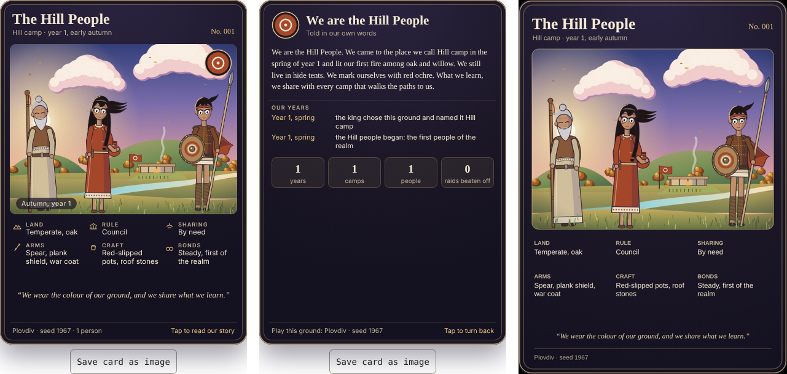

# Valley

A sandbox game of gathering, settling and growing a people, played in the browser.

**Play:** https://markmak1967-web.github.io/valley/

You are a king who arrives alone on real ground (the first map is Plovdiv, Bulgaria, at 100 m to a tile). Light a fire, gather, build huts, and families will join you. Once a camp has six people, form a family council and it will run itself, shaped by the choices you make about rule, sharing and levy.

There are no ages and no tech tree. A people's houses, tools, weapons, dress, pots and flags grow out of the land they live on and the way they are run. Ideas come from need, reward or curiosity, never just from having the materials. The year turns through four seasons, with a real winter.

Camps can stand alone or be joined by supply links, which carry goods, share ideas and answer a fort's call for levies. A camp founded on fresh ground can begin a new people of its own.

Each people earns a collector's culture card: three of its people before their house on their own ground, their traits, and on the back their history in their own words. Cards can be saved as images and shared.

## How to play

- Walk with the arrow keys or WASD, or tap the map. Tap berries, water and trees to gather.
- Press **Settle here** where the ground can sustain a camp.
- Build a fire, then huts. Wanderers arrive.
- At six people, form a council in the People tab and step back.
- The **Report** tab holds your culture cards.

The game is one HTML file with no build step and no server. It saves nothing between visits yet.
